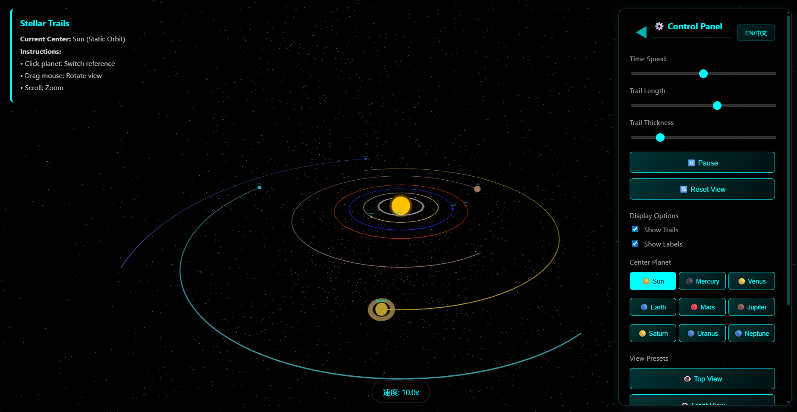
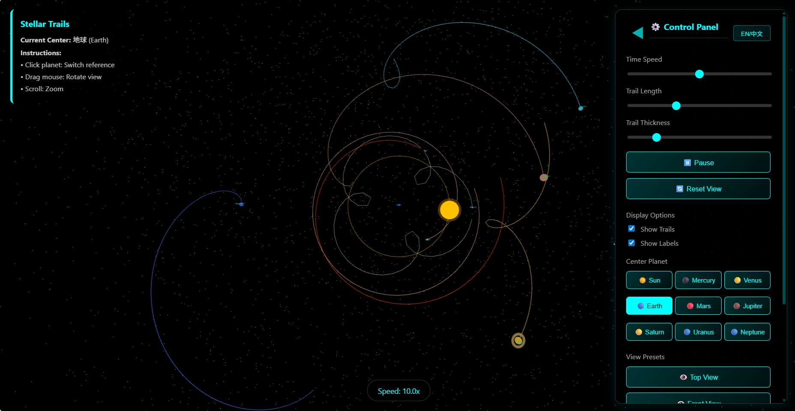

# Stellar Trails

[中文](README_ZH.md) | English

An interactive 3D solar system visualization web application featuring relative motion trails and switchable reference frames. Experience the solar system from different planetary perspectives with dynamic trail effects showing orbital paths.





## 🌟 Features

### Core Functionality
- **3D Solar System Rendering**: Complete solar system with Sun and 8 planets
- **Interactive Reference Frame Switching**: Click any planet to center your view on it
- **Dynamic Motion Trails**: Visualize orbital paths relative to the selected reference center
- **Earth's Moon**: An orbiting moon with its own motion trail (visible from Earth's reference frame)
- **Realistic Axial Tilts**: Each planet spins on a tilted axis based on real astronomical data (Uranus rolls on its side, with faint vertical rings)
- **Procedural Textures**: Unique texture patterns for each celestial body
- **Realistic Lighting System**: Point light from Sun with no falloff (evenly illuminates all planets) + ambient/hemisphere lights with shadow support
- **Bilingual Support**: English and Chinese with automatic language detection

### Controls
- **Time Speed Control**: 0x - 20x adjustable
- **Trail Length Control**: 0 - 1000 points
- **Trail Thickness Control**: 0.1 - 5.0
- **Display Options**: Toggle trails, planet labels, and performance stats
- **View Presets**: Top, Front, Side, Diagonal, and Low-angle views
- **Pause/Resume**: Stop the animation at any time

### Interaction Methods
- **Mouse Drag**: Rotate camera view
- **Scroll Wheel**: Zoom in/out
- **Click Planet**: Switch reference center
- **Control Panel Buttons**: Switch reference center + adjust camera angle
- **Keyboard Shortcuts**:
  - Space: Pause/Resume
  - 1-5: Switch view presets
  - R: Reset view
  - ESC: Close panel/Reset
  - +/-: Adjust speed
  - H: Show help

## 🚀 Quick Start

### Prerequisites
- Modern browser (Chrome, Firefox, Safari, Edge, etc.)
- ES Modules and WebGL support

### Running the Application

#### Method 1: Python HTTP Server
```bash
python3 -m http.server 8000
```
Then visit: http://localhost:8000

#### Method 2: Node.js HTTP Server
```bash
npx http-server -p 8000
```
Then visit: http://localhost:8000

#### Method 3: Using the Startup Script
```bash
./start-server.sh
```

### Offline Usage
All dependencies are downloaded to the local `libs/` directory. The application supports complete offline operation without any network connection — including web fonts (Inter and Orbitron are bundled locally in `libs/fonts/`). Verified: the page makes zero external network requests.

## 📁 Project Structure

```
/config/workspace/test/
├── index.html              # Main application file (single-file app)
├── README.md               # Project documentation (English)
├── README_ZH.md            # 项目说明文档 (中文)
├── AGENTS.md               # Developer context documentation
├── start-server.sh         # HTTP server startup script
└── libs/                   # Local dependencies
    ├── three/              # Three.js core library
    │   └── three.module.js
    ├── three-addons/       # Three.js add-ons
    │   ├── controls/
    │   │   └── OrbitControls.js
    │   ├── postprocessing/ # Post-processing chain (bloom pipeline)
    │   │   ├── EffectComposer.js
    │   │   ├── RenderPass.js
    │   │   ├── ShaderPass.js
    │   │   ├── UnrealBloomPass.js
    │   │   ├── OutputPass.js
    │   │   ├── MaskPass.js
    │   │   └── Pass.js
    │   └── shaders/        # Shader dependencies for post-processing
    │       ├── CopyShader.js
    │       ├── LuminosityHighPassShader.js
    │       └── OutputShader.js
    └── tween/              # Tween.js animation library
        └── tween.esm.js
    └── fonts/              # Local web fonts (offline)
        ├── fonts.css
        ├── inter-latin.woff2
        ├── inter-latin-ext.woff2
        └── orbitron-latin.woff2
```

## 🎮 User Guide

### Switching Reference Center
1. **Click a planet in the scene**: Immediately switch to that planet as the reference center, camera position unchanged
2. **Click control panel button**: Switch to that planet as reference center + camera moves to top-down view

### Observing Motion Trails
- After switching reference center, all celestial bodies display motion trails relative to that center
- Trail length is measured in orbits (0–2): 1.0 means the trail covers exactly one full loop of each body's own path relative to the reference frame
- Adjust trail length and thickness using sliders

### Viewing Planet Details
1. Click any planet
2. Click the "📋 Show Details" button at the bottom of the screen
3. View detailed information (distance, diameter, orbital period, etc.)

### Adjusting Camera View
- Use "View Presets" buttons in the control panel
- Or use keyboard shortcuts 1-5

## 🔧 Tech Stack

- **Three.js (v0.160.0)**: 3D graphics rendering
- **Tween.js (v23.1.1)**: Animation tweening
- **Native JavaScript ES Modules**: Modular development
- **HTML5/CSS3**: User interface and styling

## 📊 Planet Data

| Planet | Distance (AU) | Diameter (Earth ×) | Orbital Period (days) | Color |
|--------|---------------|-------------------|----------------------|-------|
| Mercury | 0.39 | 0.38 | 88 | Gray |
| Venus | 0.72 | 0.95 | 225 | Golden |
| Earth | 1.00 | 1.00 | 365 | Blue |
| Mars | 1.52 | 0.53 | 687 | Orange-red |
| Jupiter | 5.20 | 11.20 | 4,333 | Brown |
| Saturn | 9.50 | 9.45 | 10,759 | Yellow (with rings) |
| Uranus | 19.20 | 4.00 | 30,687 | Cyan |
| Neptune | 30.10 | 3.88 | 60,190 | Deep blue |

## 🎨 Control Panel

### Time Speed
- Slider range: 0x - 20x
- Real-time adjustment of planetary revolution speed

### Trail Controls
- **Length**: 0 – 2 orbits (step 0.05). The value is how many full loops of its own path each body keeps relative to the reference frame; actual point counts differ per body (proportional to orbital circumference) while loop count stays identical
- **Thickness**: 0.1 – 5.0, controls trail line thickness

### Display Options
- **Show Trails**: Toggle trail visibility
- **Show Labels**: Toggle planet name labels (supports bilingual switching)
- **Show Performance Stats**: Show live FPS / frame time / render calls / triangles / geometries

### Quality Mode
- **Performance** (default fallback): Lower geometry tessellation + 1024 shadow map + 1024×512 planet textures
- **High**: Higher tessellation + 2048 shadow map + 2048×1024 planet textures
- **Glossy (Bloom)**: Full cinematic post-processing chain (UnrealBloom) + enhanced deep-space background, on top of High settings
- **Auto Quality**: On startup the app picks a mode from device capability hints (CPU cores, mobile UA, screen size, DPR). In Glossy mode it keeps monitoring average FPS and auto-downgrades to High once if the frame rate stays below ~34 FPS. Manually picking a mode disables auto-adjustment
- **Adaptive camera distance**: The minimum zoom distance follows the focused body's true outer radius (including atmosphere shells and ring systems), so you can inspect small planets closely without the camera clipping inside them

### Center Planet
- 9 buttons corresponding to Sun and 8 planets
- Click to switch reference center

### View Presets
- Top: View from directly above
- Front: View from the front
- Side: View from the side
- Diagonal: 45-degree angle view
- Low: Low-angle view

### Language Toggle
- Click "EN/中文" button to switch between English and Chinese
- Automatically detects browser language on startup
- All UI elements and planet labels switch languages dynamically

## ⌨️ Keyboard Shortcuts

| Key | Function |
|-----|----------|
| Space | Pause/Resume animation |
| 1 | Top view |
| 2 | Front view |
| 3 | Side view |
| 4 | Diagonal view |
| 5 | Low-angle view |
| R | Reset view |
| ESC | Close info panel/Reset |
| + | Increase time speed |
| - | Decrease time speed |
| H | Show help information |

## 🔬 Special Features

### Trail System
- Based on relative coordinate calculations
- Uses fixed-capacity ring-buffer sampling to reduce allocation and array churn
- Rebuilds TubeGeometry only when a new sample is accepted (time/distance threshold)
- Automatically regenerates when switching reference centers or quality mode

### Camera System
- Smooth animation transitions
- Supports multiple view presets
- Keeps celestial body centered during focus
- Supports free rotation and zooming

### Procedural Textures
Each planet features unique procedurally generated textures:
- **Mercury**: Crater pattern
- **Venus**: Noise pattern
- **Earth**: Continent pattern with clouds, glossy ocean roughness map, and atmosphere day/night tinting
- **Mars**: Crater pattern with a thin dusty atmosphere
- **Jupiter**: Storm pattern with Great Red Spot and subtle clearcoat sheen
- **Saturn**: Banded pattern with rings and a faint atmosphere
- **Uranus**: Noise pattern with faint vertical rings
- **Neptune**: Noise pattern

### Deep-Space Background (Glossy upgrade)
- **Nebula sky dome**: Seamlessly wrapped procedural FBM nebula (purple/magenta/cyan) with a tilted Milky-Way band. Stars are drawn only by the shader star fields, never baked into the sky texture, so they stay pin-sharp at any resolution
- **Twinkling star fields**: ~13k shader-driven stars (cold white / warm / blue-white) with per-star phase twinkle, plus a dense band-star disc
- **Parallax depth**: Nebula, star fields and distant galaxies shift at different rates as the camera moves, giving the sky real depth
- **Distant spiral galaxies**: Six billboarded procedural galaxy sprites slowly rotating in the far field
- **Meteors**: Occasional shooting stars streaking across the sky (every 5–17 s)
- **Dynamic solar plasma**: A seamless 3D-noise FBM plasma layer flows over the static sun texture (stronger in Glossy mode)
- **Irregular sun rays**: Seven rays of differing length, width and brightness instead of a symmetric four-point cross
- **Solar prominences**: Irregular plasma filaments occasionally rise from the sun's limb, then dissipate. Deliberately built from hundreds of noisy line segments rather than a geometric arc — a clean circular arc reads as a UI loading spinner on screen
- **Ocean glints**: Earth's oceans produce a sharp specular sun highlight masked by the roughness map, while land stays matte
- **Saturn ring shadow**: The rings cast shadows onto the planet's cloud tops, and a faint additive halo ring sits outside the main rings

### Solar System Content
- **Main asteroid belt**: ~2,400 instanced rocks between Mars and Jupiter, positioned at the real belt range **2.2–3.2 AU** (visual radius 155–177) with radial clustering, vertical scatter (inclination ~4°–7°), size variation and per-rock colour tint
- **Jupiter Trojans**: ~840 rocks clustered at Jupiter's **L4 (leading +60°) and L5 (trailing −60°)** Lagrange points, locked to Jupiter's orbital angle so the 60° separation never drifts
- **Fixed surface landmarks**: Earth carries a fixed continent so rotation is visibly readable; Jupiter keeps its Great Red Spot anchored at a fixed longitude

### Astronomical accuracy
All orbital and rotational data maps to real values:

| Item | Handling |
|---|---|
| Semi-major axis (AU) | Real values (0.39 / 0.72 / 1.00 / 1.52 / 5.20 / 9.50 / 19.20 / 30.10) |
| Visual distance | Hand-tuned non-linear compression (50→450), preserving a dense-inner / sparse-outer feel |
| Orbital speed | Strictly inverse to the real orbital period (`speed = 0.73 / periodDays`), so relative planet arrangement is always correct |
| Rotation speed | Strictly inverse to the real rotation period (Earth 23.934 h as reference) |
| Axial tilt | Real values (Mercury 0.03°, Venus 177.4°, Earth 23.44°, Mars 25.19°, Jupiter 3.13°, Saturn 26.73°, Uranus 97.77°, Neptune 28.32°) |
| Spin direction | Venus and Uranus spin retrograde |
| Moon | Radius ratio 0.2726 (Earth × 0.2726 ≈ 0.68), orbital period 27.32 days |

### Motion Trails (Glossy upgrade)
- Trail length is measured in **orbits**, not points: the slider sets how many full loops each body keeps relative to the current reference frame (0–2, default 1.0)
- Trails are **pre-filled analytically**: since every orbit is circular motion with a linear-in-time angle, the past N loops can be computed exactly at the moment you change the setting or switch the reference frame. Saturn/Neptune show a complete ring instantly (previously you had to wait ~10–143 real minutes at 1x for the buffer to fill)
- Every body samples its own path at a fixed arc-length step, so a body's point count is proportional to its orbital circumference (Neptune keeps ~2.4k points per orbit, the Moon ~50), while the **number of preserved loops is identical for all bodies**
- Arc-length sampling also means trails fill in uniformly at any time speed — outer planets no longer need ages to accumulate a full ring
- Trails fade and taper along their length: bright and thick at the head (newest sample), thin and dim at the tail
- Trail colours are desaturated and lifted toward the deep-space palette so they no longer glare against the black background
- Tube segments scale with sample count, so complex paths (like the Moon's epicycloid seen from the Sun) stay smooth
- Switching the reference centre seeds each trail immediately from its current position, avoiding a visible blank gap

### Bilingual Support
- Automatic language detection based on browser settings
- Manual language toggle via control panel
- All UI elements dynamically switch languages
- Planet labels update in real-time when language changes

## ✅ Performance Verification

1. Run locally:
   - `python3 -m http.server 8000` or `npx http-server -p 8000`
   - Open `http://localhost:8000`
2. Regression scenarios:
   - Switch center: Sun / Earth / Jupiter
   - Toggle trails and quickly adjust trail length/thickness
   - Toggle info panel and switch view presets
3. Compare before/after (Chrome DevTools Performance, 30-60s):
   - Average FPS, P95 frame time, GC frequency
   - `renderer.info.render.calls`, `renderer.info.render.triangles`, `renderer.info.memory.geometries`
4. Suggested acceptance:
   - Noticeable P95 frame-time improvement with trails enabled and long length
   - No obvious trail flicker/break or interaction regressions
   - Stable geometry/memory indicators without continuous growth

## 📄 License

This project is for learning and demonstration purposes only.

## 🤝 Contributing

Issues and Pull Requests are welcome!

---

**Enjoy exploring the solar system!** 🌌